  

<table>
  <tr>
    <td valign="top"></td>
    <td valign="top"></td>
  </tr>
</table>

 

<table>
  <tr>
    <td valign="top"></td>
    <td valign="top"></td>
  </tr>
</table>

 

### 🧩 Why LeetCode is part of my routine

LeetCode is my daily workout. I treat it the way I treat the gym: show up every day, even if it's just one problem. My first goal was 300 problems; I'm past that now, almost all of them in Java, and the streak counter keeps me honest.

What it has given me:

- **Pattern recognition.** Arrays, hashing, two pointers, binary search and DP feel like tools I reach for now, not puzzles.
- **Better Java.** Hundreds of solutions taught me collections, edge cases and time complexity better than any course.
- **Thinking against a clock.** Contests push me to solve under pressure, which carries straight into interviews and hackathons.

My notes and solutions live in [DSA-Prep](https://github.com/Abhishek6122008/DSA-Prep) and [Leet-Code](https://github.com/Abhishek6122008/Leet-Code). Come say hi on [LeetCode](https://leetcode.com/u/Abhi_1905/).

 

  

  

